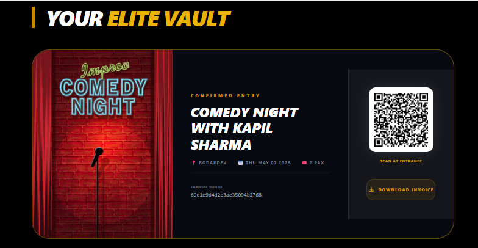
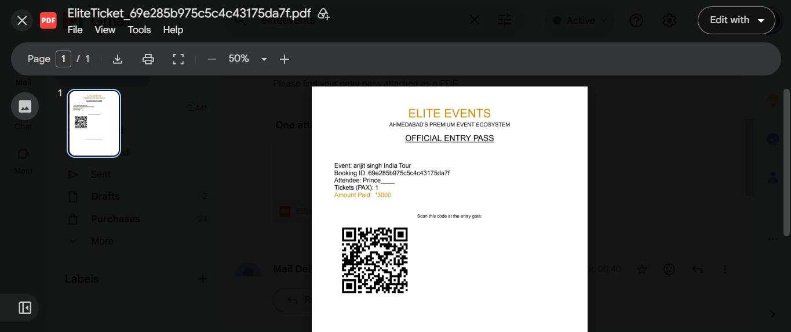

# EliteEvents

A full-stack event management web app built with the MERN stack.

## Features
- User authentication
- Browse and book events
- QR code ticket generation and scanning
- Real-time updates with Socket.io
- Online payments with Razorpay

## Tech Stack
- **Frontend:** React (Vite), Tailwind CSS, React Router, Axios
- **Backend:** Node.js, Express.js, MongoDB
- **Other:** Socket.io, Razorpay

## Folder Structure
- `client/` – React frontend
- `server/` – Express backend (config, controllers, middleware, models, routes, services, utils)

## Getting Started

### 1. Backend
cd server
cp .env.example .env    # then fill in your values
npm install
npm start

### 2. Frontend
cd client
cp .env.example .env    # then fill in your values
npm install
npm run dev

## Screenshots
## Screenshots

### Landing Page

### Events

### Create Event

### Organizer Dashboard

### Payment (Razorpay Test Mode)

### QR Ticket

### Email Confirmation with Ticket

## Author
Prashant Parihar